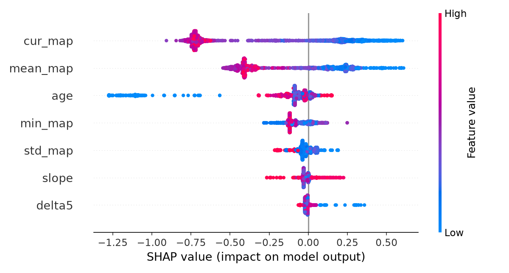

# Intraoperative Hypotension Early Warning

A small end-to-end machine learning project: given the last 10 minutes of mean arterial pressure (MAP) readings and the patient's age, estimate the risk that MAP will drop below 65 mmHg in the next 15 minutes.

> **Important: this project uses simulated data only.** No real patients were involved. The model is trained and evaluated on 600 synthetic cases, and the simulator contains a warning signal by design. The results show that the pipeline works end to end. They do **not** show how well the model would perform on real patients. This is a course/portfolio project, **not a medical device**, and must not be used for clinical decisions.

**Live demo:** [frontend](https://hypotension-prediction-frontend.vercel.app/) · [API](https://hypotension-prediction.onrender.com/docs)
*(The API runs on a free plan and sleeps when idle. The first request can take up to a minute.)*

---

## How it works

```
 Browser                      Vercel                       Render / Railway
┌──────────┐   loads page   ┌────────────┐                ┌─────────────────────┐
│  user    │ ─────────────> │ frontend/  │                │ backend/main.py     │
│          │                │ index.html │                │ FastAPI + XGBoost   │
│          │ ───── POST /predict (10 MAP values, age) ───> │ models/xgb.json     │
│          │ <──── risk score, alert flag, top drivers ─── │                     │
└──────────┘                └────────────┘                └─────────────────────┘
```

1. `scripts/make_synthetic_data.py` simulates 600 surgical cases (one MAP value per minute).
2. `src/train_model.py` turns them into 10-minute windows, trains an XGBoost classifier, and saves the model to `models/`.
3. `backend/main.py` loads the model and serves predictions as an API.
4. `frontend/index.html` is a static page that calls the API and shows the score, the alert, and which features moved it.

## Repository structure

```
hypotension-prediction/
├── README.md
├── requirements.txt            # server dependencies (what the host installs)
├── requirements-train.txt      # training, plotting and test dependencies
├── docs/
│   └── data_dictionary.md      # columns, label definition, limitations
├── scripts/
│   └── make_synthetic_data.py  # generates the simulated dataset (seed 42)
├── data/raw/                   # generated CSV, not committed
├── src/
│   ├── data_loader.py          # windowing, features, labels
│   ├── metrics.py              # AUROC, AUPRC, PPV at 80% sensitivity, bootstrap
│   └── train_model.py          # training, evaluation, SHAP plot, saves model
├── models/
│   ├── xgb.json                # trained model (committed, the API loads it)
│   └── meta.json               # feature order and alert threshold
├── reports/
│   └── shap_summary.png        # feature importance plot from training
├── backend/
│   └── main.py                 # FastAPI app
├── frontend/
│   ├── index.html              # the web page
│   └── config.js               # sets the API address
└── tests/
    └── test_api.py             # API tests
```

## The prediction task

- **Input:** the last 10 minutes of MAP (one reading per minute) and age.
- **Label:** 1 if the area below 65 mmHg over the next 15 minutes is at least 20 mmHg·min, otherwise 0. This is deliberately stricter than "MAP below 65 for one minute".
- **Skipped windows:** windows whose latest MAP is already below 65 (nothing left to predict) and windows with missing values.
- **Features (7):** current MAP, mean, standard deviation, minimum, linear slope, change over the last 5 minutes, and age. Full definitions are in [`docs/data_dictionary.md`](docs/data_dictionary.md).

## Model and evaluation

- XGBoost with class weighting (events are only about 5% of windows), early stopping on validation AUPRC.
- The train, validation and test sets are split **by patient**, so windows from one patient never appear on both sides.
- The alert threshold is the highest score that still catches 80% of events on the validation set.
- The baseline is "just watch MAP": the model must beat a score based on the current MAP alone. The confidence interval resamples whole patients.

Example run on the simulated data (your numbers will differ slightly, because training is not seeded):

| | AUROC | AUPRC |
|---|---|---|
| XGBoost | 0.749 | 0.262 |
| Current MAP only | 0.607 | 0.102 |

The AUPRC gain over the MAP-only baseline was 0.16 (95% interval 0.10 to 0.23). The model wins because the simulator includes a gradual MAP decline before most episodes, which the slope and change features can pick up. Real patients would behave differently.



The risk output is a **weighted score, not a calibrated probability**. Class weighting inflates it, so it is shown as "Risk score", not a percentage.

## Run it locally

Requires Python 3.10 or newer (developed and tested on 3.12).

```bash
pip install -r requirements-train.txt

# 1. generate the simulated dataset
python scripts/make_synthetic_data.py

# 2. train, evaluate, save models/ and reports/shap_summary.png
python src/train_model.py data/raw/synthetic_map_data.csv

# 3. run the tests
python -m pytest -q

# 4. start the API
uvicorn backend.main:app --port 8000
```

Then open `frontend/index.html` in a browser (`frontend/config.js` points at `http://localhost:8000` by default) and click **Estimate risk**. The interactive API docs are at `http://localhost:8000/docs`.

## API

**`GET /health`** returns `{"status": "ok"}`.

**`POST /predict`**

Request:
```json
{"readings": [84, 83, 82, 80, 79, 77, 76, 74, 73, 71], "age": 62}
```

Rules: exactly 10 readings, each between 20 and 200 mmHg, oldest first; age between 1 and 110. Anything else returns `422`.

Response:
```json
{
  "risk": 0.97,
  "alert": true,
  "threshold": 0.36,
  "drivers": [{"feature": "slope", "value": -1.46, "push": 1.62}]
}
```

- `risk`: model score between 0 and 1.
- `alert`: true when the score is at or above the threshold from `models/meta.json`.
- `drivers`: the 5 features that moved this score the most. `push` is the feature's contribution in log-odds units; positive raises the risk.

## Deployment

**Backend (Render or Railway)**
- Connect the GitHub repo and keep the **root directory at the repo root**, since the server reads `src/` and `models/`.
- Build command (Render): `pip install -r requirements.txt`
- Start command: `uvicorn backend.main:app --host 0.0.0.0 --port $PORT`
- Environment variable `ALLOWED_ORIGINS`: your frontend address, https://hypotension-prediction-frontend.vercel.app (no trailing slash). If unset, any website may call the API.
- Check `/health` after the build finishes.

**Frontend (Vercel)**
- Set `window.API_URL` in `frontend/config.js` to https://hypotension-prediction.onrender.com, then commit and push.
- Import the repo and set **Root Directory** to `frontend`. No build step is needed

`models/xgb.json` and `models/meta.json` must be committed, because the deployed API loads them at startup.

## Limitations

- All data is simulated, and the warning signal is built into the simulator, so the metrics describe the simulator, not patients.
- The model sees only MAP and age. It does not use medications, surgery type, heart rate or other real clinical signals.
- The risk score is not calibrated.
- Training is not seeded, so retraining gives a slightly different model.
- Not validated, not approved, and not for clinical use.

## Team

- Dhruv Shah: data generation, backend, deployment
- Akshat Gupta: data loading and labelling, model training and metrics, explanations
